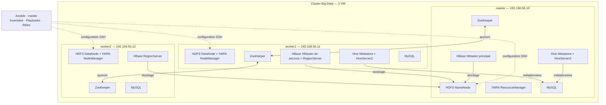

<div align="center">

# Big Data Analytics Architecture Lab

### Infrastructure distribuée, services analytiques et automatisation Ansible

**Apache Hadoop · HDFS · YARN · Apache Hive · Apache HBase · Apache ZooKeeper · MySQL · Ansible**


</div>

---

## Sommaire

1. [Présentation](#1-présentation)
2. [Objectifs du lab](#2-objectifs-du-lab)
3. [Architecture globale](#3-architecture-globale)
4. [Topologie et répartition des services](#4-topologie-et-répartition-des-services)
5. [Stack technique](#5-stack-technique)
6. [Structure du dépôt](#6-structure-du-dépôt)
7. [Déploiement avec Ansible](#7-déploiement-avec-ansible)
8. [Configuration et fichiers importants](#8-configuration-et-fichiers-importants)
9. [Vérification et administration](#9-vérification-et-administration)
10. [Haute disponibilité et limites](#10-haute-disponibilité-et-limites)
11. [Sécurité et bonnes pratiques](#11-sécurité-et-bonnes-pratiques)

## 1. Présentation

Ce dépôt regroupe les travaux d'un **laboratoire d'architectures analytiques Big Data**, centré sur la conception, la configuration et l'exploitation d'un cluster distribué de **trois machines virtuelles**.

L'infrastructure combine plusieurs couches complémentaires :

- **Stockage distribué** : HDFS (Hadoop Distributed File System).
- **Gestion des ressources** : YARN, avec prise en charge de MapReduce.
- **Analyse SQL** : Apache Hive et ses services Metastore / HiveServer2.
- **Base NoSQL distribuée** : Apache HBase, adossée à HDFS.
- **Coordination distribuée** : quorum Apache ZooKeeper.
- **Métadonnées relationnelles** : MySQL, avec des rôles destinés à InnoDB Cluster.
- **Infrastructure as Code** : Ansible (inventaires, rôles, playbooks et templates Jinja2).

> **Périmètre** : projet de laboratoire à visée pédagogique et expérimentale, et non plateforme de production prête à l'emploi.

## 2. Objectifs du lab

- Comprendre les **différentes couches d'une architecture Big Data** et leurs interactions.
- Déployer et administrer un **cluster Hadoop multinœud**.
- Expérimenter le **traitement analytique SQL** via Hive.
- Mettre en place HBase et étudier la **gestion des données NoSQL**.
- Comprendre le rôle de ZooKeeper dans la **coordination** et le basculement des services.
- Explorer les mécanismes de **redondance et de haute disponibilité**.
- Industrialiser l'installation et la configuration à l'aide d'**Ansible**.

## 3. Architecture globale



**Lecture de l'architecture :**

1. **HDFS** stocke les données du cluster ; le NameNode maintient les métadonnées des fichiers.
2. **YARN** gère les ressources nécessaires à l'exécution des traitements.
3. **Hive** fournit une interface SQL et s'appuie sur un Metastore dont les métadonnées sont enregistrées dans MySQL.
4. **HBase** conserve ses données dans HDFS et utilise ZooKeeper pour la coordination du cluster.
5. **Ansible** centralise l'installation et la configuration depuis `master`.

## 4. Topologie et répartition des services

| Nœud | Adresse privée | Services prévus par l'inventaire et les rôles |
|---|---|---|
| `master` | `192.168.56.10` | Contrôleur Ansible, NameNode, ResourceManager, ZooKeeper, HMaster principal, Hive Metastore, HiveServer2, MySQL |
| `worker1` | `192.168.56.11` | DataNode, NodeManager, ZooKeeper, HMaster de secours, RegionServer, Hive Metastore, HiveServer2, MySQL |
| `worker2` | `192.168.56.12` | DataNode, NodeManager, ZooKeeper, RegionServer, MySQL |

**Groupes Ansible importants** : `masters`, `workers`, `hadoop_cluster`, `hbase_masters`, `hbase_regionservers` et `hbase_cluster`.

> La distribution ci-dessus décrit la topologie **ciblée par le dépôt**. Elle ne certifie pas que tous les services sont actuellement actifs sur les VM.

## 5. Stack technique

| Technologie | Version déclarée dans le dépôt | Rôle |
|---|---|---|
| Apache Hadoop | `3.4.3` | Écosystème HDFS / YARN / MapReduce |
| Apache Hive | `4.0.1` | Couche analytique SQL |
| Apache HBase | `2.5.16` | Base NoSQL distribuée |
| Apache ZooKeeper | `3.8.7` | Coordination et quorum |
| MySQL Server | `8.0` (paquet Ubuntu épinglé) | Stockage des métadonnées et expérimentation InnoDB Cluster |
| Java | OpenJDK `11` | Environnement JVM des services |
| Ansible | Version non épinglée | Automatisation des déploiements |
| Jinja2 / systemd | Selon l'environnement | Génération des configurations / gestion des services |

## 6. Structure du dépôt

```text
.
├── ansible.cfg                 # Configuration Ansible
├── inventory/
│   ├── hosts.ini               # Nœuds, adresses et groupes
│   └── group_vars/
│       ├── all.yml             # Variables globales du cluster
│       └── all/                # Variables complémentaires et secrets Vault
├── group_vars/
│   └── all.yml                 # Autre jeu de variables globales (à harmoniser)
├── files/                      # Archives locales des distributions
├── playbooks/
│   ├── site.yml                # Socle système, Java et Hadoop
│   ├── zookeeper.yml           # ZooKeeper distribué
│   ├── mysql-install.yml       # Serveurs MySQL
│   ├── mysql-shell.yml         # MySQL Shell
│   ├── mysql-group-replication.yml
│   ├── mysql-cluster-create.yml
│   ├── mysql-router-install.yml
│   ├── hive-ha.yml             # Services Hive redondants
│   ├── hive-ha-prepare.yml     # Variante de préparation Hive HA
│   ├── hbase-precheck.yml      # Vérifications des prérequis
│   ├── hbase-install.yml       # Installation HBase
│   ├── hbase-config.yml        # Configuration HBase
│   └── hbase-start.yml         # Démarrage et tests HBase
├── roles/
│   ├── common/                 # Prérequis système
│   ├── java/                   # Installation Java
│   ├── hadoop/                 # Installation Hadoop
│   ├── hadoop_env/             # Variables d'environnement Hadoop
│   ├── hadoop_config/          # Templates XML Hadoop
│   ├── config_final/           # Finalisation et démarrage Hadoop
│   ├── zookeeper/              # Quorum ZooKeeper
│   ├── mysql_server/           # MySQL Server
│   ├── mysql_shell/            # MySQL Shell
│   ├── mysql_group_replication/ # Préparation Group Replication
│   ├── mysql_cluster_bootstrap/ # Initialisation InnoDB Cluster
│   ├── mysql_router/           # Installation MySQL Router
│   ├── hive_ha/                # Metastore et HiveServer2 redondants
│   ├── hbase/                  # Installation HBase
│   ├── hbase_config/           # Configuration distribuée HBase
│   └── hbase_runtime/          # Services, démarrage et validation HBase
└── README.md
```

D'autres rôles de support (`hdfs`, `yarn`, `ssh_trust`, `services`) sont également présents dans le dépôt.

## 7. Déploiement avec Ansible

### 7.1. Prérequis

- Trois VM Linux accessibles entre elles sur le réseau privé `192.168.56.0/24`.
- Un utilisateur `vagrant` disposant des droits nécessaires pour les tâches `become`.
- Ansible installé sur la VM **`master`**, utilisée comme **nœud de contrôle**.
- Connectivité SSH de `master` vers `worker1` et `worker2`.
- Accès aux archives/binaires ou aux dépôts nécessaires à l'installation.
- Mot de passe **Ansible Vault** disponible pour les fichiers chiffrés.

Toutes les commandes ci-dessous sont exécutées **depuis `master`**, dans `~/cluster-ansible`.

### 7.2. Vérifier l'inventaire et la connectivité

```bash
cd ~/cluster-ansible

ansible-inventory --graph
ansible all -m ping --ask-vault-pass
```

### 7.3. Déployer le socle Hadoop et ZooKeeper

```bash
ansible-playbook playbooks/site.yml --ask-vault-pass
ansible-playbook playbooks/zookeeper.yml --ask-vault-pass
```

> **Attention au premier lancement :** dans le rôle `config_final`, la tâche de formatage du NameNode s’exécute si `current/VERSION` est absent. Vérifier l’état des données HDFS avant de lancer `site.yml` ; ne jamais supprimer ce fichier pour « réparer » un cluster existant.

Vérifier que le NameNode HDFS écoute bien sur `master:9000` **avant** d'aller plus loin.

### 7.4. Préparer MySQL et la couche Hive

```bash
ansible-playbook playbooks/mysql-install.yml --ask-vault-pass
ansible-playbook playbooks/mysql-shell.yml --ask-vault-pass
ansible-playbook playbooks/mysql-group-replication.yml --ask-vault-pass
```

L'initialisation MySQL InnoDB Cluster nécessite **une base `metastore_db` existante, non vide, ainsi qu'une sauvegarde SQL préalable**. Après validation de ces prérequis :

```bash
ansible-playbook playbooks/mysql-cluster-create.yml --ask-vault-pass
```

L'installation de MySQL Router, sans bootstrap automatique du routeur dans le rôle actuel, est disponible via :

```bash
ansible-playbook playbooks/mysql-router-install.yml --ask-vault-pass
```

Pour Hive, une installation **Hive 4.0.1 et son `hive-site.xml` doivent déjà être présents sur `master`**, avec une base Metastore accessible. Le playbook suivant déploie les services Hive sur `master` et `worker1` :

```bash
ansible-playbook playbooks/hive-ha.yml --ask-vault-pass
```

> `hive-ha-prepare.yml` constitue une autre procédure présente dans le dépôt : ne pas cumuler les deux procédures sans vérifier les configurations et les unités `systemd` qu'elles modifient.

### 7.5. Déployer HBase

Une fois **HDFS et ZooKeeper opérationnels** :

```bash
ansible-playbook playbooks/hbase-precheck.yml --ask-vault-pass
ansible-playbook playbooks/hbase-install.yml --ask-vault-pass
ansible-playbook playbooks/hbase-config.yml --ask-vault-pass
ansible-playbook playbooks/hbase-start.yml --ask-vault-pass
```

Le dernier playbook vérifie le démarrage des HMasters et RegionServers et contient un **test fonctionnel d'écriture/lecture** avec la table `ansible_hbase_smoke` (activé par défaut).

## 8. Configuration et fichiers importants

| Fichier / template | Fonction principale |
|---|---|
| `inventory/hosts.ini` | Déclaration des nœuds et de leurs rôles |
| `inventory/group_vars/all.yml` | Variables Hadoop, chemins, version et réplication |
| `roles/hadoop_config/templates/core-site.xml.j2` | Point d'entrée HDFS : `fs.defaultFS=hdfs://master:9000` |
| `roles/hadoop_config/templates/hdfs-site.xml.j2` | Répertoires NameNode / DataNode et facteur de réplication |
| `roles/hadoop_config/templates/yarn-site.xml.j2` | ResourceManager et services NodeManager |
| `roles/hadoop_config/templates/mapred-site.xml.j2` | Exécution MapReduce sur YARN |
| `roles/zookeeper/templates/zoo.cfg.j2` | Quorum ZooKeeper à trois membres |
| `roles/hbase_config/templates/hbase-site.xml.j2` | HBase distribué, stockage HDFS et quorum ZooKeeper |
| `roles/hbase_config/templates/hbase-env.sh.j2` | Java, Hadoop, JVM et journaux HBase |
| `roles/hive_ha/files/configure_hive_ha.py` | Génération des configurations Hive Metastore / HiveServer2 |
| `roles/mysql_cluster_bootstrap/templates/create-cluster.js.j2` | Script MySQL Shell d'initialisation du cluster |

**Paramètres structurants du lab** :

```text
HDFS / fs.defaultFS         hdfs://master:9000
HBase / hbase.rootdir       hdfs://master:9000/hbase
ZooKeeper / quorum          master:2181,worker1:2181,worker2:2181
Hive Metastore / Thrift     master:9083,worker1:9083
HiveServer2 / Thrift        master:10000,worker1:10000
MySQL / port standard       3306
```

## 9. Vérification et administration

### 9.1. Hadoop / HDFS / YARN

```bash
# Depuis master, avec l'environnement Hadoop configuré
jps
hdfs dfsadmin -report
hdfs dfs -ls /
yarn node -list
```

Interfaces web usuelles (accessibles si les services et le réseau le permettent) :

- **HDFS NameNode** : `http://192.168.56.10:9870`
- **YARN ResourceManager** : `http://192.168.56.10:8088`

### 9.2. ZooKeeper

```bash
sudo systemctl status zookeeper
/opt/zookeeper/bin/zkServer.sh --config /etc/zookeeper status
```

### 9.3. HBase

```bash
sudo systemctl status hbase-master
sudo systemctl status hbase-regionserver
/opt/hbase/bin/hbase shell
```

Dans le shell HBase :

```ruby
status 'simple'
list
```

Interface HMaster : `http://192.168.56.10:16010` ; une interface de secours peut être disponible sur `worker1:16010`.

### 9.4. Hive et MySQL

```bash
sudo systemctl status hive-metastore
sudo systemctl status hive-hs2
sudo systemctl status mysql
```

Les services Hive écoutent respectivement sur **9083** (Metastore) et **10000** (HiveServer2), sous réserve de leur démarrage et des règles réseau.

## 10. Haute disponibilité et limites

| Sous-système | Configuration visée | Point de vigilance |
|---|---|---|
| ZooKeeper | Quorum sur trois nœuds | La tolérance aux pannes dépend du quorum réellement actif |
| HBase | Deux HMasters et deux RegionServers | Nécessite la disponibilité de HDFS et ZooKeeper |
| Hive | Metastore et HiveServer2 sur deux nœuds | Les deux services utilisent une base de métadonnées commune |
| MySQL | Préparation de trois instances pour InnoDB Cluster | Le script fourni initialise un **premier membre** ; l'ajout des autres membres n'est pas automatisé dans ce script |
| HDFS | Un NameNode, deux DataNodes prévus | **Pas de haute disponibilité du NameNode** configurée dans le dépôt |
| MySQL Router | Paquet installé sur les nœuds Hive | Le rôle ne réalise pas le bootstrap et l'activation du routage |

**Autres points à vérifier** :

- Les fichiers `group_vars/all.yml` et `inventory/group_vars/all.yml` contiennent des valeurs différentes (notamment pour la réplication HDFS) : harmoniser la source des variables avant le déploiement.
- La configuration actuelle de `hive_ha` vise directement `192.168.56.10:3306` pour MySQL : un véritable basculement côté base nécessite une configuration de routage appropriée.
- Le playbook de démarrage HBase attend un NameNode accessible sur `master:9000` ; un cluster HDFS arrêté ou mal configuré bloque donc cette étape.

## 11. Sécurité et bonnes pratiques

- Conserver les mots de passe dans **Ansible Vault**, jamais dans les exemples de commandes ni dans la documentation.
- Vérifier les fichiers chiffrés et les droits sur les configurations Hive avant toute publication du dépôt.
- Réserver les ports d'administration aux réseaux autorisés ; ne pas exposer inutilement HDFS, HBase, ZooKeeper ou MySQL sur Internet.
- Ne **jamais reformater le NameNode** d’un cluster contenant des données. Dans le code actuel, la tâche de formatage du rôle `config_final` teste l’absence de `current/VERSION` mais **ne vérifie pas** la variable `format_namenode` déclarée dans ses valeurs par défaut. Auditer cette condition avant une utilisation sur des données existantes.
- Exécuter les playbooks de façon progressive, vérifier les dépendances et conserver des sauvegardes du Metastore.

---

<div align="center">

**Big Data Analytics Lab — Distributed Architecture & Infrastructure Automation**

*Un projet d'expérimentation autour des architectures analytiques, du stockage distribué et de l'automatisation DevOps.*

</div>
